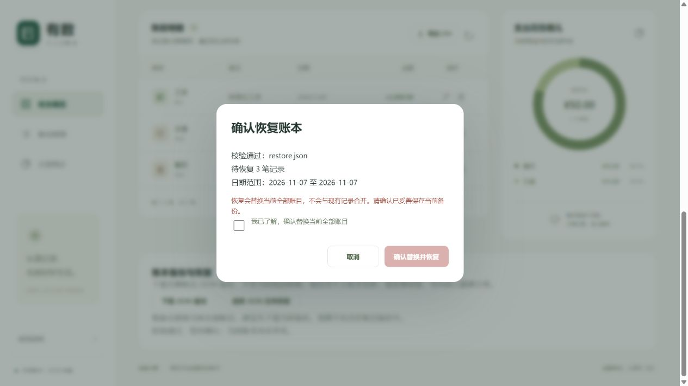

# 备份恢复整合说明

本分支保留 PR #14 的备份恢复界面与原作者提交，补齐主项目根目录缺失的后端接口，并整合最新 main。
修复此前前端合并时拼接整份文件导致的重复 JavaScript 声明、重复 HTML 文档与重复样式，保留记账、预算和 CSV 导出。

## 改动
- 后端补齐：版本化 JSON 导出，完整字段与重复 ID 校验；恢复前保留 ledger.json.before-restore.bak，验证后原子替换并更新内存；增加只校验不写入的预览接口。
- #7：下载及本地文件选择、服务端校验结果/记录数/日期范围预览、替换全部账目警告、勾选确认、取消/加载/错误提示及恢复后刷新。
- 文件上限为 5 MiB，备份仅包含账目，不包含独立预算文件。回退文件会被下一次恢复覆盖。

## 验证
python -m unittest discover -s tests：17 项通过。
node --check static/app.js：通过。
新增覆盖预览无写入、非法备份不变、恢复重启一致性、写入失败及 HTTP 导出/预览/恢复。
浏览器验证使用独立测试账本：下载备份包含原有两笔记录；取消恢复和非法 JSON 不改账本；375 × 812 手机视口下确认恢复三笔记录后，收入 2,000 元、支出 50 元、结余 1,950 元，100 元预算剩余 50 元；筛选交通后 CSV 仅包含对应一笔记录。控制台错误为空。尚未使用真实手机测试。

